# ExTrans — Hướng dẫn sử dụng

ExTrans là tiện ích mở rộng cho Chrome/Edge giúp dịch giọng nói trực tiếp (thời gian thực) trong cuộc họp, lớp học hoặc video. Tên các nút và menu bên dưới được ghi đúng như giao diện tiếng Anh mặc định của ứng dụng.

> **Lưu ý về API key:** để dịch trực tiếp bằng dịch vụ đám mây, bạn cần **API key của chính bạn** (OpenAI, Google Gemini, Doubao, Soniox, ...). Bước 6 hướng dẫn tạo khóa Gemini. Khóa chỉ được lưu trên thiết bị của bạn; đừng chia sẻ hay đăng khóa ở bất kỳ đâu. Trong video có phần chạy thật, khóa được che kín trên màn hình khi nhập.

Video hướng dẫn (mỗi bước đều có vòng vàng chỉ chỗ cần bấm): [`media/extrans-user-guide.mp4`](media/extrans-user-guide.mp4)

Trong ảnh và video: **vòng vàng + số** là nơi cần bấm, **vòng vàng nét đứt + chữ cái (A, B)** là chỗ cần chú ý nhưng không bấm. Số "Bước N" khớp với phụ đề trong video. Toàn bộ ảnh và video được quay ở giao diện **Light** (sáng).

## 1. Cài đặt bản chưa đóng gói (Load unpacked)

**Bước 1.** Mở Chrome, gõ `chrome://extensions` vào thanh địa chỉ rồi nhấn Enter.

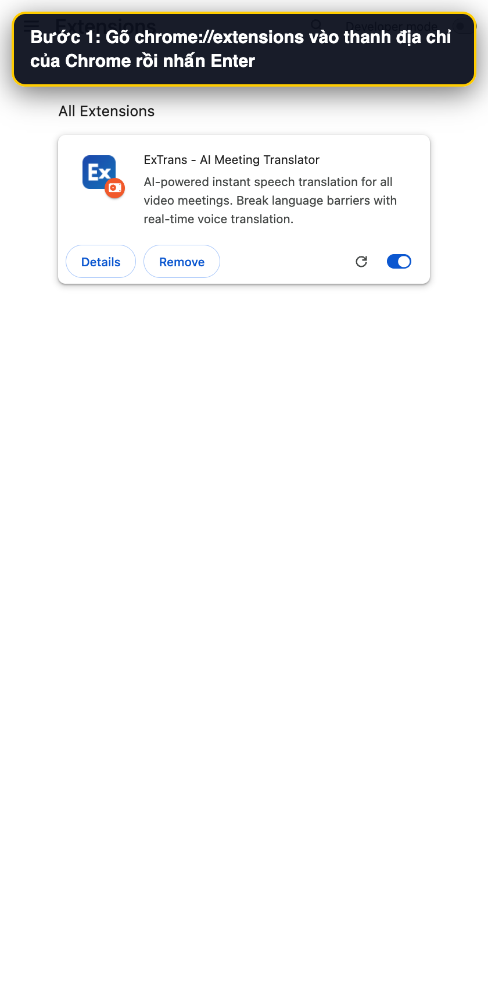

**Bước 2.** Bật công tắc **Developer mode** ở góc trên bên phải.

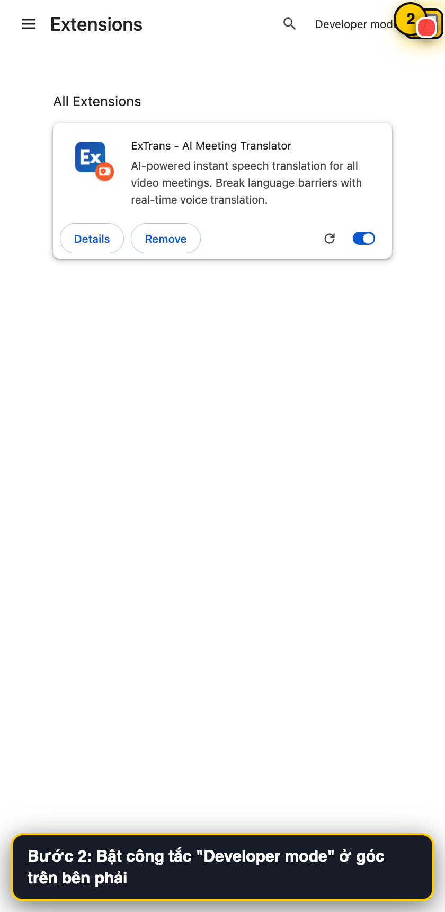

**Bước 3.** Bấm **Load unpacked**. Hộp thoại chọn thư mục của hệ điều hành sẽ mở ra; chọn thư mục `extension/dist` của dự án ExTrans rồi bấm **Select**. (Hộp thoại này thuộc hệ điều hành nên video chỉ hiện thẻ chữ hướng dẫn chọn thư mục nào.)

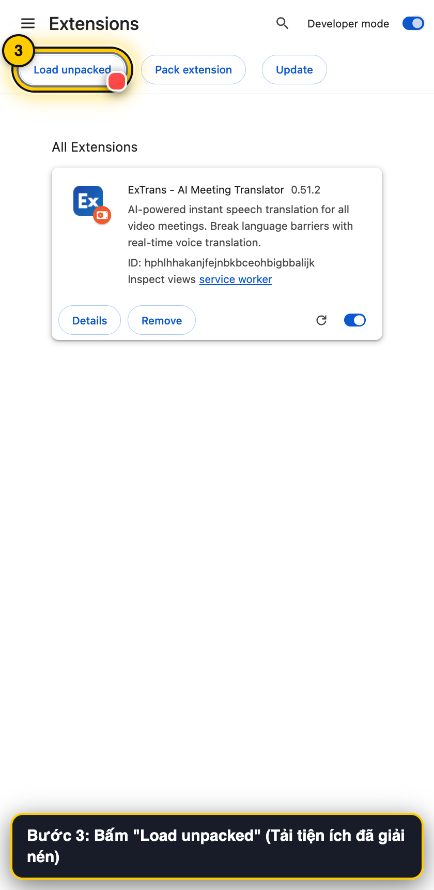

**Bước 4.** Thẻ **ExTrans** xuất hiện trong danh sách tiện ích; công tắc ở góc phải thẻ phải đang bật.

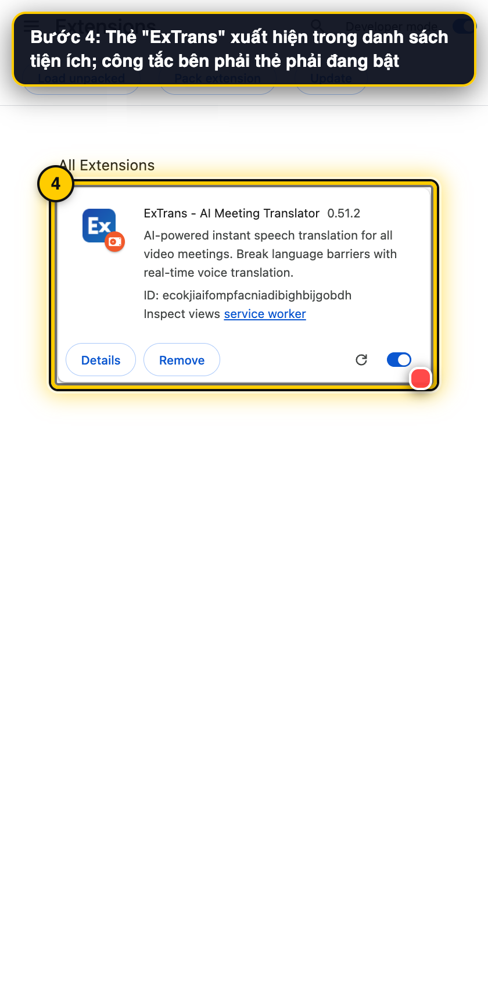

**Bước 5.** Ghim ExTrans lên thanh công cụ để dễ mở: bấm biểu tượng **mảnh ghép** (Extensions) cạnh thanh địa chỉ, rồi bấm biểu tượng **ghim** cạnh ExTrans. (Phần này của Chrome không quay được nên video chỉ hiện thẻ chữ.)

## 2. Tạo Gemini API key

Phần này chỉ là hướng dẫn bằng chữ (không có ảnh), vì trang của Google có thể đổi giao diện. Nếu bạn dùng nhà cung cấp khác, xem liên kết "How to get this key" trong trình hướng dẫn.

**Bước 6.**

1. Vào [aistudio.google.com/apikey](https://aistudio.google.com/apikey) (Google AI Studio).
2. Đăng nhập bằng tài khoản Google của bạn.
3. Bấm **Create API key**.
4. Chọn một dự án (project) có sẵn hoặc tạo dự án mới.
5. Sao chép khóa vừa tạo. Giữ khóa riêng tư: không gửi cho người khác, không đăng lên mạng hay đưa vào ảnh chụp màn hình.

## 3. Mở ExTrans

**Bước 7.** Mở một trang web được hỗ trợ (ví dụ Google Meet), bấm biểu tượng ExTrans, rồi bấm **Open ExTrans**. Bảng điều khiển ExTrans sẽ mở ở thanh bên (side panel).

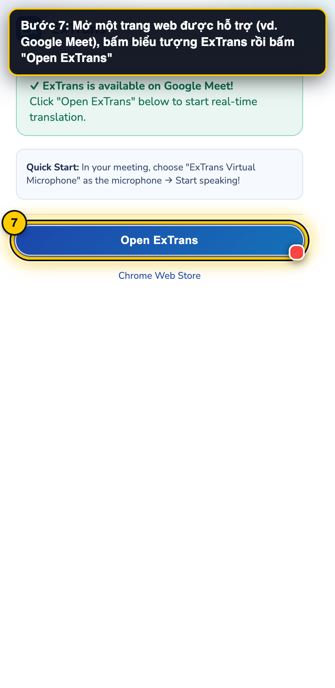

> Trong ảnh/video, cửa sổ popup và side panel được mở như một trang thường để quay màn hình; giao diện bên trong giống hệt.

## 4. Thiết lập lần đầu (6 bước)

Lần đầu mở, ExTrans hiện trình hướng dẫn **Set up ExTrans**. Chưa có gì được lưu cho đến khi bạn bấm **Finish**, nên có thể bấm **Back** để đổi ý.

**Bước 8 (Thiết lập 1/6) — Ngôn ngữ giao diện.** Chọn ngôn ngữ của menu và nút (ô A, mặc định English), rồi bấm **Next**.

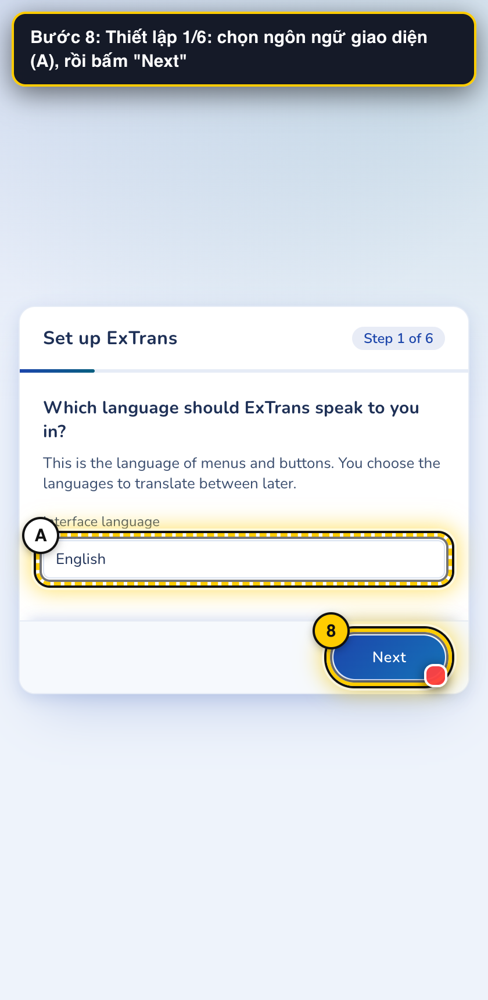

**Bước 9 (Thiết lập 2/6) — Tình huống.** Bấm vào thẻ mô tả đúng nhu cầu nhất (ví dụ "Understand what others say" để đọc bản dịch lời người khác nói), rồi bấm **Next**.

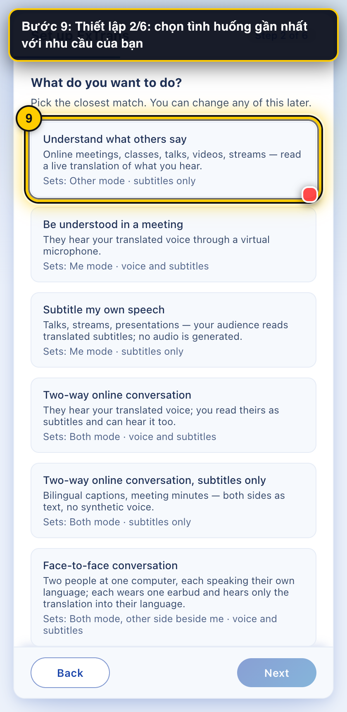

**Bước 10 (Thiết lập 3/6) — Nhà cung cấp AI.** Chọn **I have my own API key** để dùng khóa của bạn, rồi bấm vào nhà cung cấp bạn có tài khoản (trong video là **Google Gemini**). Liên kết A ("guides for every provider") chỉ cách lấy khóa cho từng nhà cung cấp. Bấm **Next**.

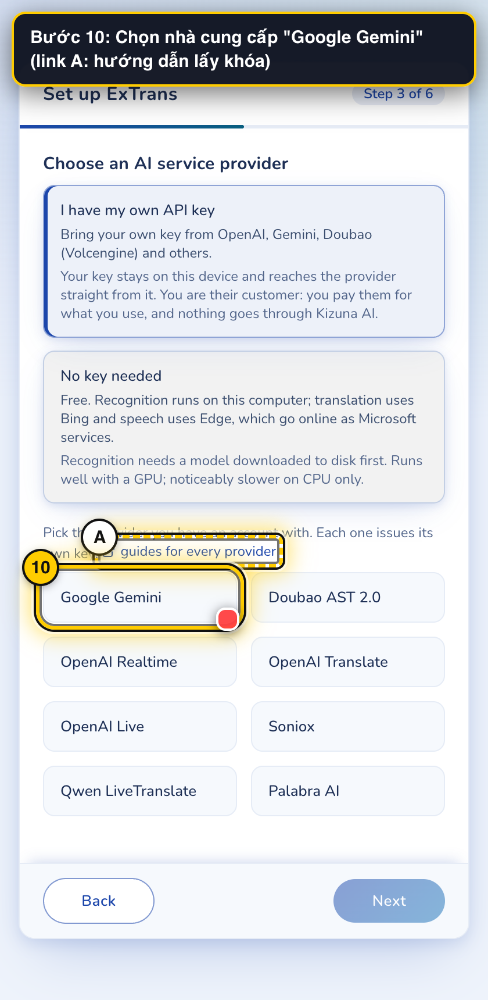

**Bước 11 (Thiết lập 4/6) — API key.** Ô A là nơi dán API key; liên kết B ("How to get this key") mở hướng dẫn lấy khóa.

- Đã có khóa: bấm vào ô A, dán khóa, bấm **Validate** và đợi thông báo "Key accepted.", rồi bấm **Next**.
- Chưa có khóa: bấm **Skip for now** và thêm khóa sau trong Settings (xem mục 7). Bản quay không có khóa đi theo đường này.

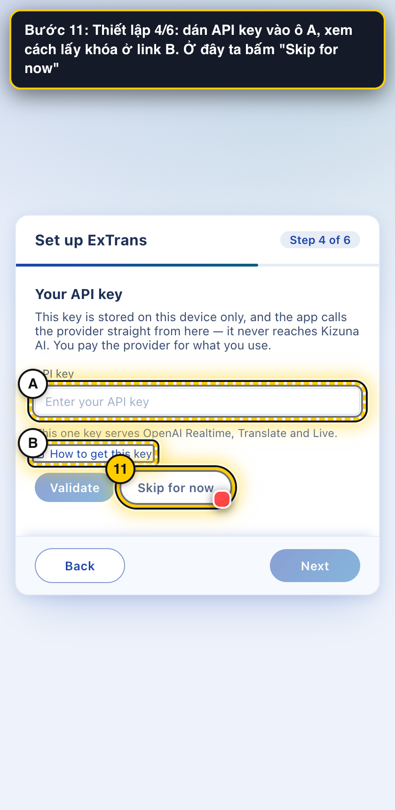

**Bước 12 (Thiết lập 5/6) — Cặp ngôn ngữ.** Chọn ngôn ngữ nguồn (A: thứ được nói, ở đây là English) và ngôn ngữ đích (B: thứ bạn muốn đọc/nghe, ở đây là Vietnamese), rồi bấm **Next**.

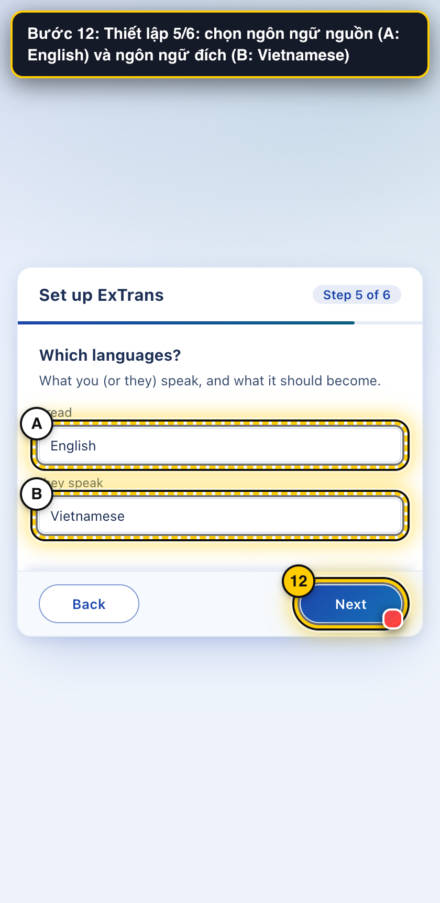

**Bước 13 (Thiết lập 6/6) — Xác nhận.** Xem lại tóm tắt (tình huống, chế độ, nhà cung cấp, ngôn ngữ) và bấm **Finish**. Nếu bạn đã bấm "Skip for now", sẽ có dòng cảnh báo "No API key yet" — đó là bình thường.

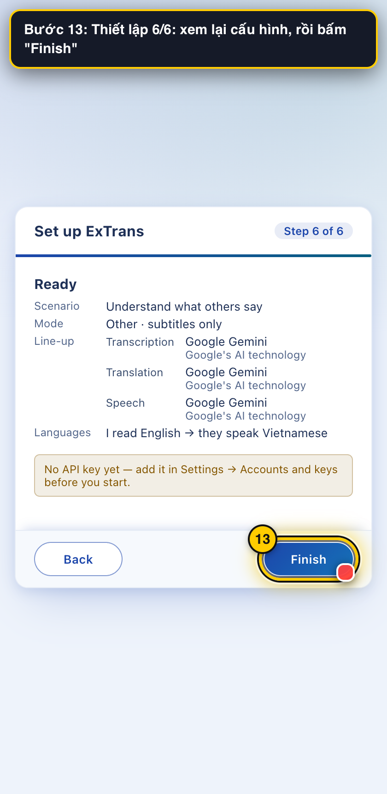

## 5. Hướng dẫn nhanh (tour)

Sau **Finish**, ExTrans chạy một tour ngắn trên màn hình chính.

**Bước 14.** Bấm **Next** để xem từng phần, hoặc **Skip** (A) để bỏ qua.

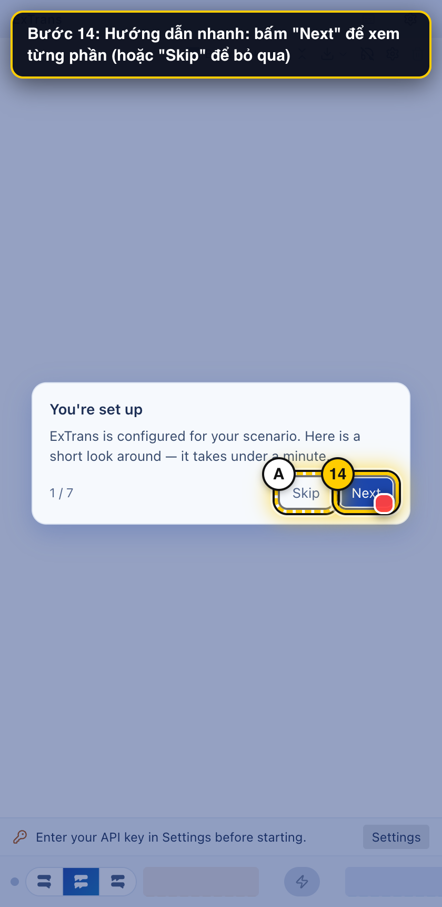

**Bước 15.** Phần tiếp theo giới thiệu bộ chọn chế độ. Bấm **Next** để tiếp tục tới hết tour (**Finish** ở cuối), hoặc **Skip** để kết thúc ngay. Có thể xem lại tour bất cứ lúc nào bằng **Settings → General → Guide → Start again**.

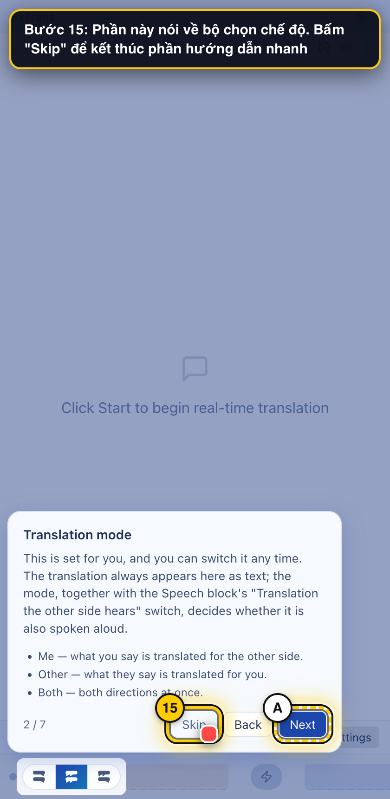

## 6. Bắt đầu một phiên dịch và chọn chế độ

**Bước 16.** Màn hình chính có hai phần chính:

- **A — bộ chọn chế độ:** **Me** (dịch giọng của bạn), **Other** (dịch giọng người khác/âm thanh của tab), **Both** (cả hai).
- **B — nút Start:** bấm để bắt đầu dịch; bấm lại (lúc này là **Stop**) để dừng. Nút chỉ dùng được sau khi API key đã được thêm và hợp lệ; trước đó ExTrans hiện dòng "Enter your API key in Settings before starting."

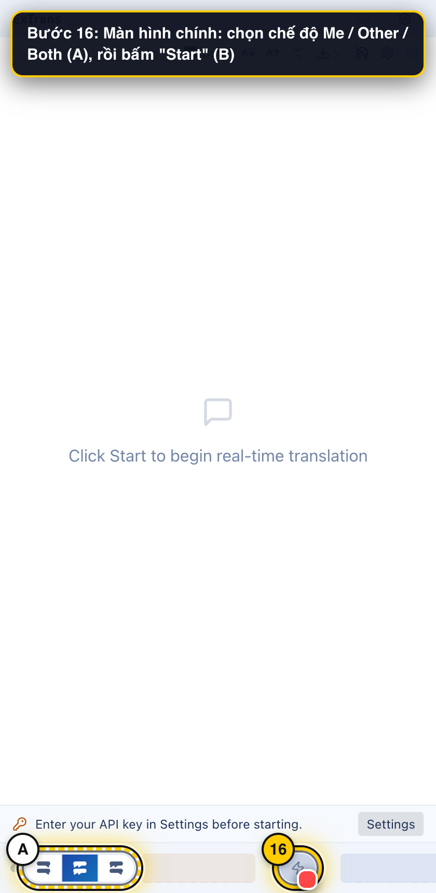

**Bước 17.** Chọn chế độ **Me** để dịch giọng của chính bạn.

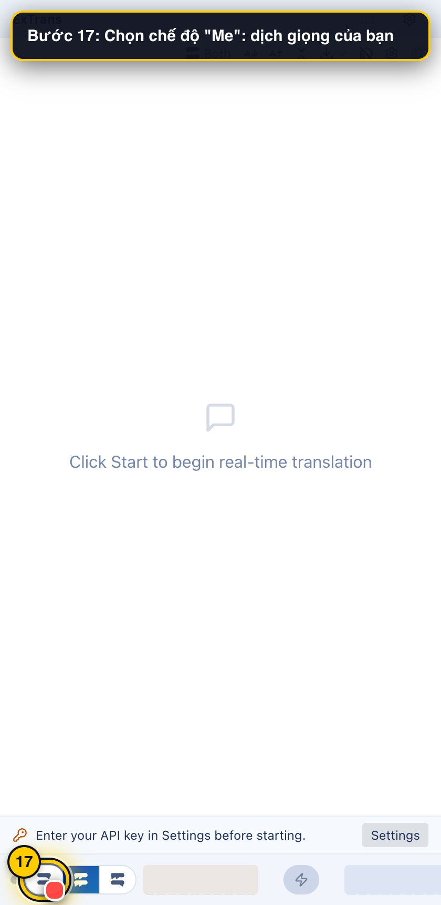

**Bước 18.** Bấm **Start**: ExTrans nghe micro và các dòng bản dịch hiện dần trong khung hội thoại. Bấm **Stop** để dừng. Trong bản quay có khóa, micro được thay bằng một giọng đọc tiếng Anh tổng hợp và video chờ vài dòng bản dịch tiếng Việt xuất hiện trước khi bấm Stop; trong bản quay không có khóa, nút Start chỉ được tô sáng (chưa bấm được vì chưa có khóa).

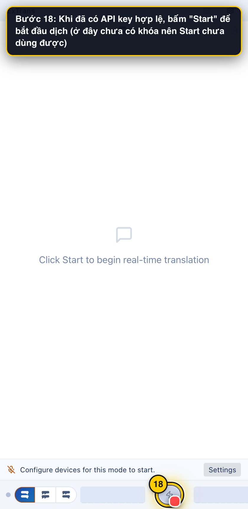

Khi bắt đầu lần đầu, trình duyệt sẽ hỏi quyền dùng micro — chọn **Allow**.

## 7. Cài đặt (Settings)

**Bước 19.** Bấm **Settings** ở thanh trên cùng.

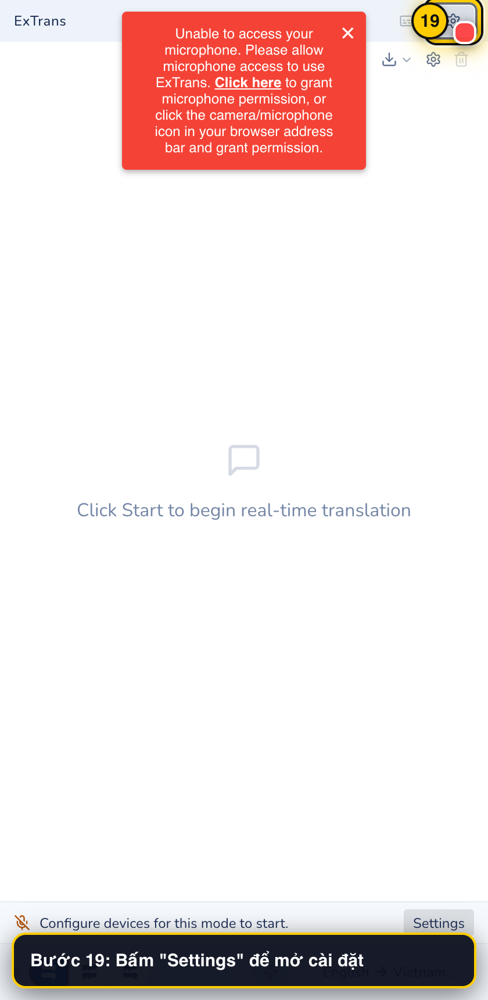

**Bước 20.** Danh sách mục cài đặt. Bấm **Accounts and keys** để thêm hoặc đổi API key; **General** (A) chứa giao diện sáng/tối, ngôn ngữ giao diện và trình hướng dẫn thiết lập.

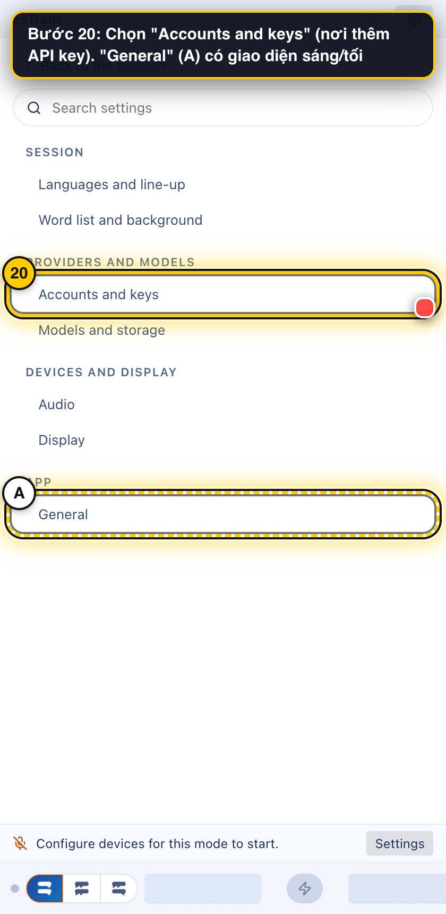

**Bước 21.** Trong **Accounts and keys** (A), chọn nhà cung cấp và dán API key của bạn vào ô tương ứng. Khóa chỉ được lưu trên thiết bị này. Bấm **Back to the list** để quay lại.

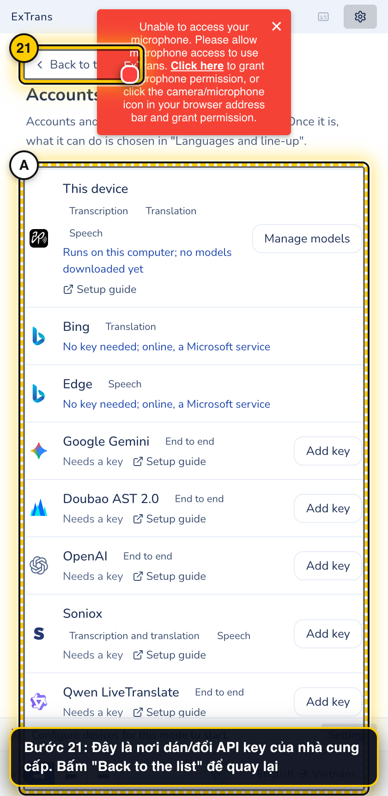

### Giao diện sáng / tối

ExTrans có hai giao diện: **Light** (sáng) và **Dark** (tối); **System** theo hệ điều hành. Ảnh và video trong hướng dẫn này dùng giao diện Light. Vào **Settings → General → Appearance**:

**Bước 22.** Mục **Appearance** (A) đang ở **Light**. Bấm **Dark** để chuyển sang giao diện tối.

**Bước 23.** Giao diện đã chuyển sang tối. Bấm **Light** để quay lại giao diện sáng, rồi bấm **Back to the list**. Thay đổi có hiệu lực ngay, không cần tải lại.

| Giao diện sáng (Light) | Giao diện tối (Dark) |
|---|---|
| 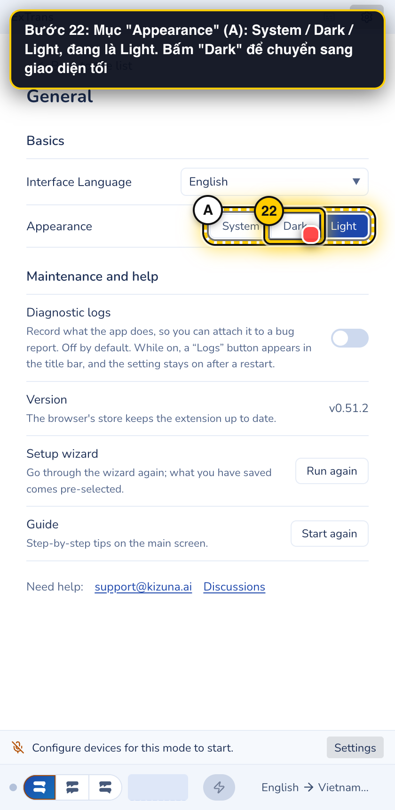 | 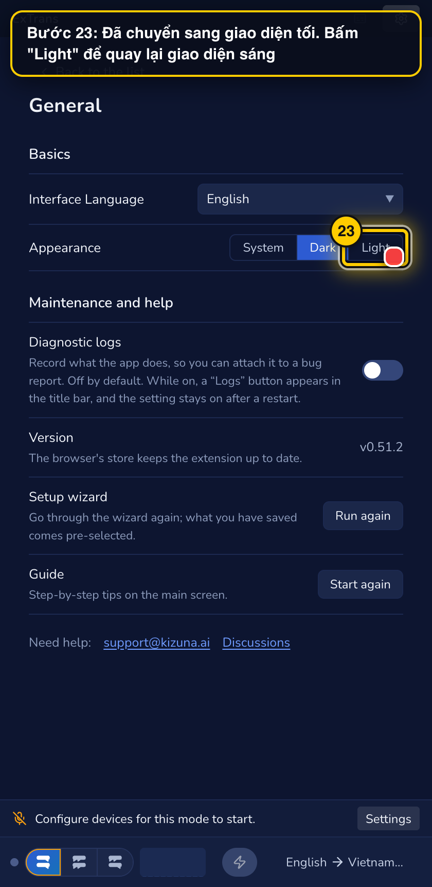 |

**Bước 24.** Bấm **Back to the session** để về màn hình chính.

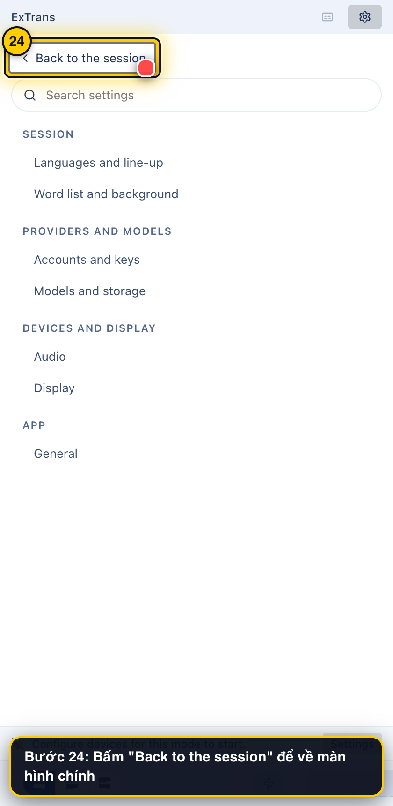

## 8. Xử lý sự cố

- **Không nghe/thấy gì, hoặc micro không hoạt động:** bấm biểu tượng ổ khóa cạnh thanh địa chỉ → cho phép **Microphone** cho ExTrans, rồi mở lại side panel. Kiểm tra micro đã chọn ở **Settings → Audio**.
- **Không có tiếng dịch:** chọn chế độ đúng (**Other** để dịch âm thanh của tab), kiểm tra âm lượng tab và thiết bị đầu ra trong **Settings → Audio**; trong cuộc họp, chọn "ExTrans Virtual Microphone" làm micro nếu muốn người khác nghe bản dịch.
- **Nút Start bị khóa / "API key invalid":** vào **Settings → Accounts and keys**, dán lại khóa (không thừa dấu cách), bấm **Validate**. Kiểm tra khóa còn hạn mức và đúng nhà cung cấp đã chọn.
- **Muốn đổi nhà cung cấp, ngôn ngữ hoặc làm lại từ đầu:** **Settings → General → Setup wizard → Run again**.

## Giấy phép

ExTrans dựa trên Sokuji của Kizuna AI Lab, được cấp phép theo AGPL-3.0.

ExTrans is based on Sokuji by Kizuna AI Lab, licensed under AGPL-3.0.
