# ExTrans — Hướng dẫn sử dụng

ExTrans là tiện ích mở rộng cho Chrome/Edge giúp dịch giọng nói trực tiếp (thời gian thực) trong cuộc họp, lớp học hoặc video. Tên các nút và menu bên dưới được ghi đúng như giao diện tiếng Anh mặc định của ứng dụng.

> **Lưu ý về API key:** để dịch trực tiếp bằng dịch vụ đám mây, bạn cần **API key của chính bạn** (OpenAI, Google Gemini, Doubao, Soniox, ...). Hướng dẫn này không bao giờ nhập hay hiển thị khóa nào; ở bước 5 ta chỉ bấm "Skip for now" và thêm khóa sau trong Settings.

Video hướng dẫn (mỗi bước đều có vòng vàng chỉ chỗ cần bấm): [`media/extrans-user-guide.mp4`](media/extrans-user-guide.mp4)

Trong ảnh và video: **vòng vàng + số** là nơi cần bấm, **vòng vàng nét đứt + chữ cái (A, B)** là chỗ cần chú ý nhưng không bấm. Số "Bước N" khớp với phụ đề trong video.

## 1. Cài đặt

- **Từ cửa hàng** (khi đã phát hành): mở trang ExTrans trên Chrome Web Store hoặc Edge Add-ons và bấm **Add to Chrome / Get**.
- **Bản phát triển (load unpacked):** mở `chrome://extensions`, bật **Developer mode**, bấm **Load unpacked** rồi chọn thư mục `extension/dist` của dự án.

Sau khi cài, ghim biểu tượng ExTrans lên thanh công cụ (biểu tượng ghép hình → ghim) để dễ mở.

## 2. Mở ExTrans

**Bước 1.** Mở một trang web được hỗ trợ (ví dụ Google Meet), bấm biểu tượng ExTrans, rồi bấm **Open ExTrans**. Bảng điều khiển ExTrans sẽ mở ở thanh bên (side panel).

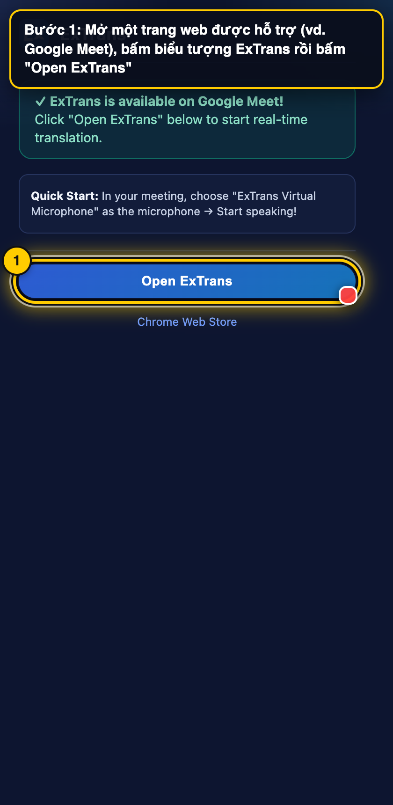

> Trong ảnh/video, cửa sổ popup và side panel được mở như một trang thường để quay màn hình; giao diện bên trong giống hệt.

## 3. Thiết lập lần đầu (6 bước)

Lần đầu mở, ExTrans hiện trình hướng dẫn **Set up ExTrans**. Chưa có gì được lưu cho đến khi bạn bấm **Finish**, nên có thể bấm **Back** để đổi ý.

**Bước 2 (Thiết lập 1/6) — Ngôn ngữ giao diện.** Chọn ngôn ngữ của menu và nút (ô A, mặc định English), rồi bấm **Next**.

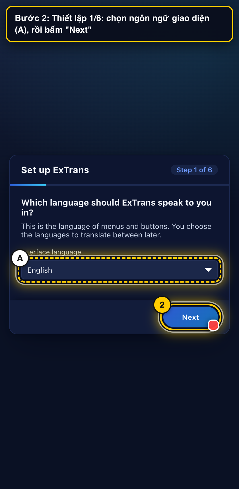

**Bước 3 (Thiết lập 2/6) — Tình huống.** Bấm vào thẻ mô tả đúng nhu cầu nhất (ví dụ "Understand what others say" để đọc bản dịch lời người khác nói), rồi bấm **Next**.

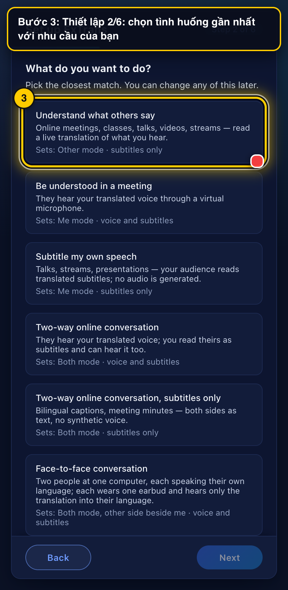

**Bước 4 (Thiết lập 3/6) — Nhà cung cấp AI.** Chọn **I have my own API key** để dùng khóa của bạn (hoặc "Start right away" / "No key needed" nếu có), rồi bấm vào nhà cung cấp bạn có tài khoản. Liên kết A ("guides for every provider") chỉ cách lấy khóa cho từng nhà cung cấp. Bấm **Next**.

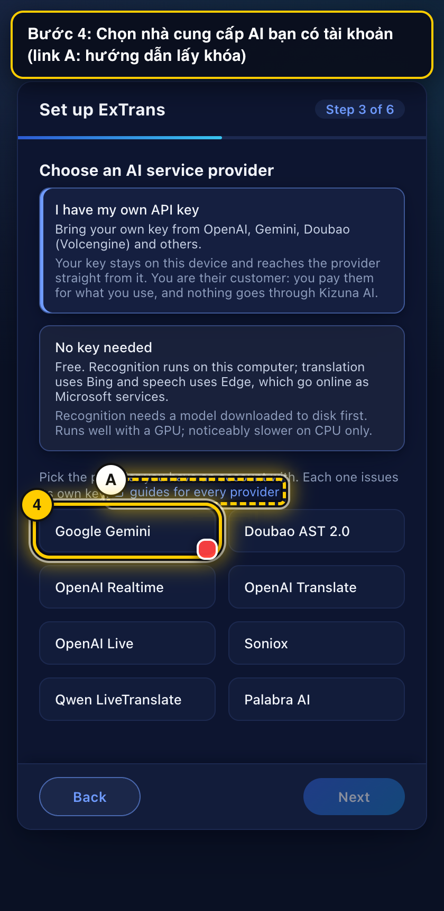

**Bước 5 (Thiết lập 4/6) — API key.** Ô A là nơi dán API key; liên kết B ("How to get this key") mở hướng dẫn lấy khóa. Nếu chưa có khóa, bấm **Skip for now** — bạn thêm khóa sau trong Settings (xem mục 6). Nếu đã có khóa, dán vào ô A và bấm **Validate**.

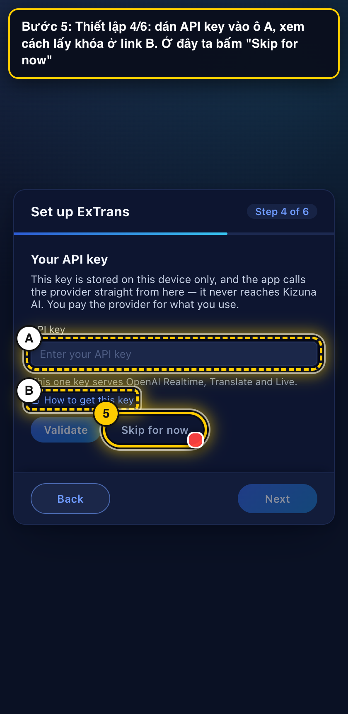

**Bước 6 (Thiết lập 5/6) — Cặp ngôn ngữ.** Chọn ngôn ngữ nguồn (A: thứ được nói) và ngôn ngữ đích (B: thứ bạn muốn đọc/nghe), rồi bấm **Next**.

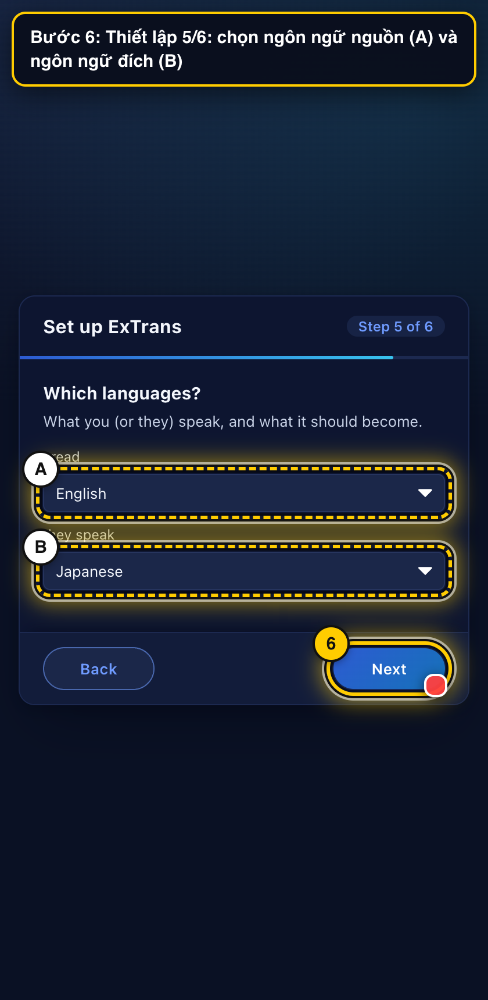

**Bước 7 (Thiết lập 6/6) — Xác nhận.** Xem lại tóm tắt (tình huống, chế độ, nhà cung cấp, ngôn ngữ) và bấm **Finish**. Nếu bạn đã bấm "Skip for now", sẽ có dòng cảnh báo "No API key yet" — đó là bình thường.

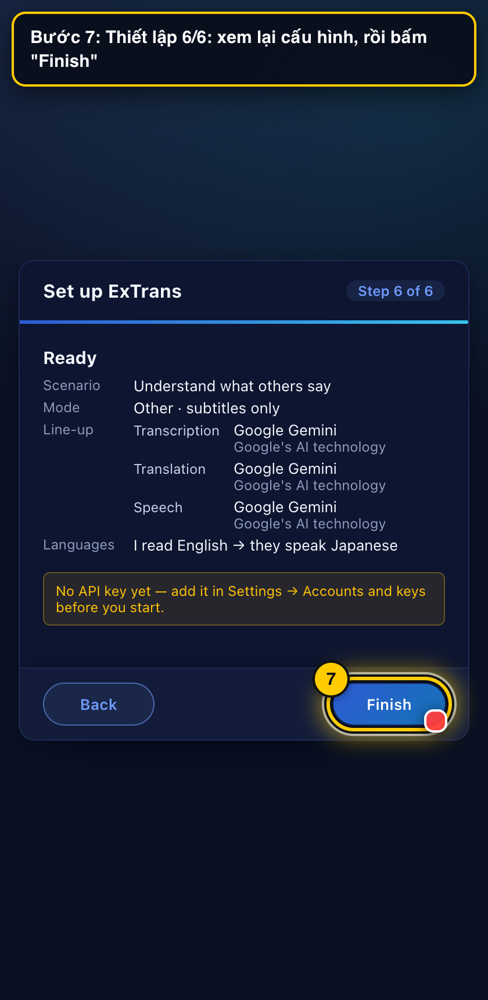

## 4. Hướng dẫn nhanh (tour)

Sau **Finish**, ExTrans chạy một tour ngắn trên màn hình chính.

**Bước 8.** Bấm **Next** để xem từng phần, hoặc **Skip** (A) để bỏ qua.

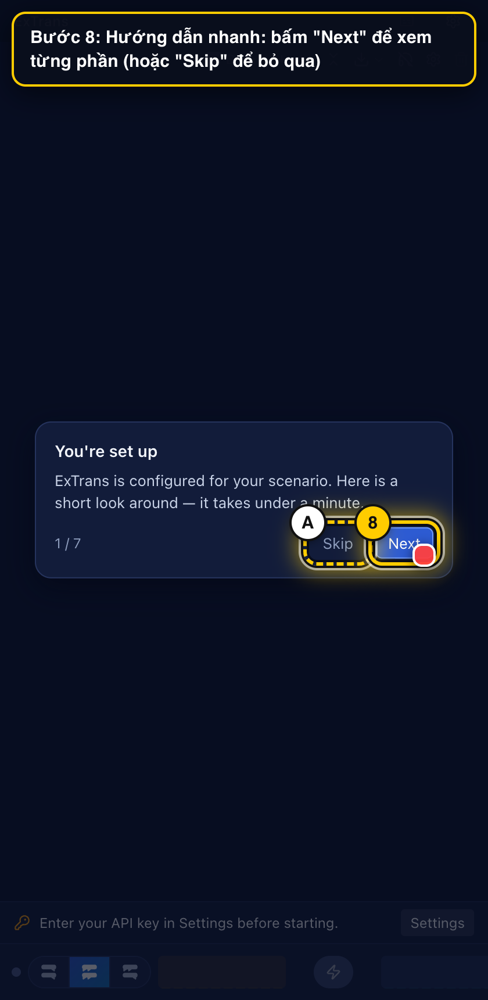

**Bước 9.** Phần tiếp theo giới thiệu bộ chọn chế độ. Bấm **Next** để tiếp tục tới hết tour (**Finish** ở cuối), hoặc **Skip** để kết thúc ngay. Có thể xem lại tour bất cứ lúc nào bằng **Settings → General → Guide → Start again**.

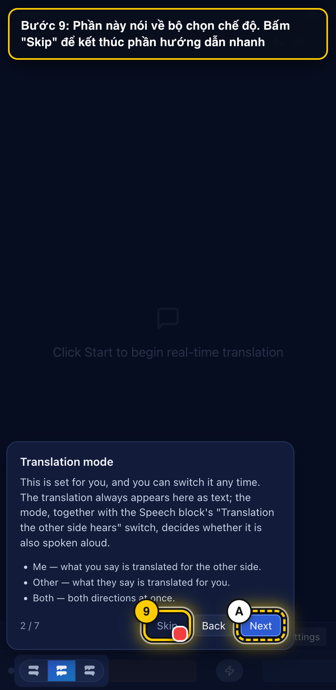

## 5. Bắt đầu một phiên dịch và chọn chế độ

**Bước 10.** Ở màn hình chính:

- **A — bộ chọn chế độ:** **Me** (dịch giọng của bạn), **Other** (dịch giọng người khác/âm thanh của tab), **Both** (cả hai).
- **B — nút Start:** bấm để bắt đầu dịch; bấm lại để dừng. Nút chỉ dùng được sau khi API key đã được thêm và hợp lệ; trước đó ExTrans hiện dòng "Enter your API key in Settings before starting."

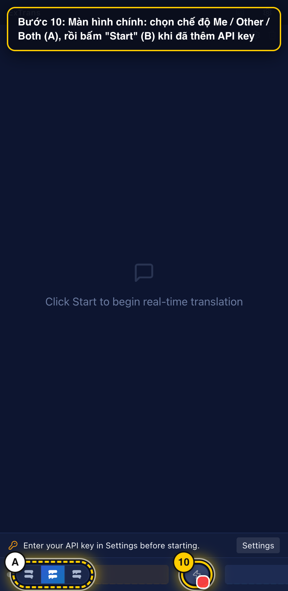

Khi bắt đầu lần đầu, trình duyệt sẽ hỏi quyền dùng micro — chọn **Allow**.

## 6. Cài đặt (Settings)

**Bước 11.** Bấm **Settings** ở thanh trên cùng.

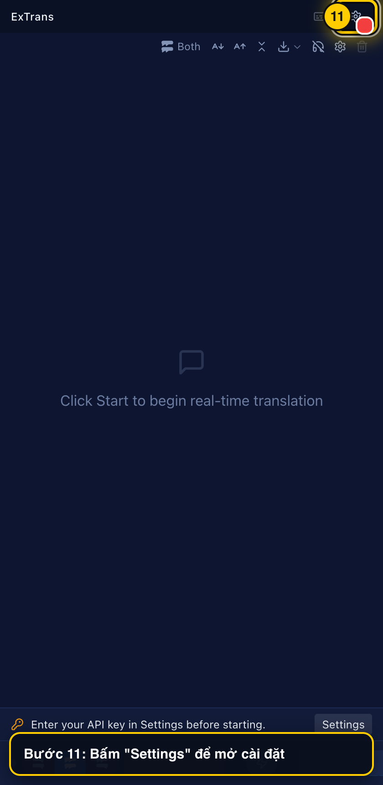

**Bước 12.** Danh sách mục cài đặt. Bấm **Accounts and keys** để thêm hoặc đổi API key; **General** (A) chứa giao diện sáng/tối, ngôn ngữ giao diện và trình hướng dẫn thiết lập.

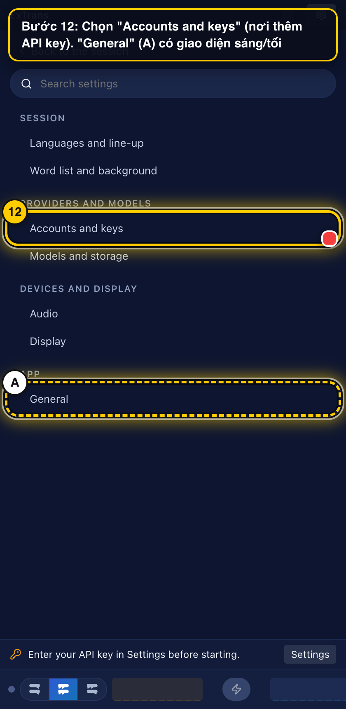

**Bước 13.** Trong **Accounts and keys** (A), chọn nhà cung cấp và dán API key của bạn vào ô tương ứng. Khóa chỉ được lưu trên thiết bị này. Bấm **Back to the list** để quay lại.

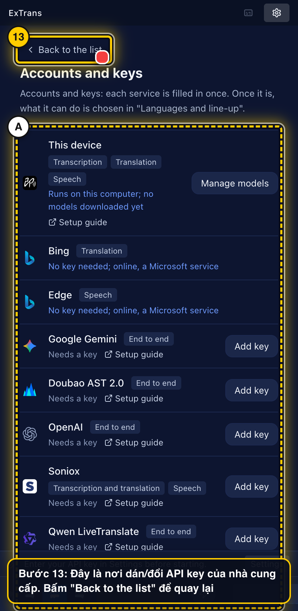

### Giao diện sáng / tối

ExTrans có hai giao diện: **Dark** (mặc định) và **Light**; **System** theo hệ điều hành. Vào **Settings → General → Appearance**:

**Bước 14.** Bấm **Light** để chuyển sang giao diện sáng. **Bước 15.** Bấm **Dark** để quay lại giao diện tối. Thay đổi có hiệu lực ngay, không cần tải lại.

| Giao diện tối (Dark) | Giao diện sáng (Light) |
|---|---|
| 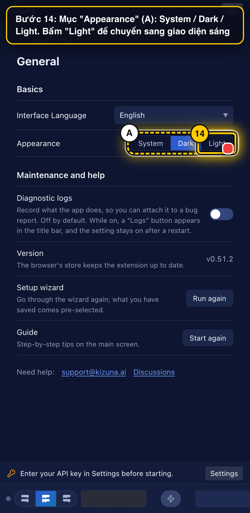 | 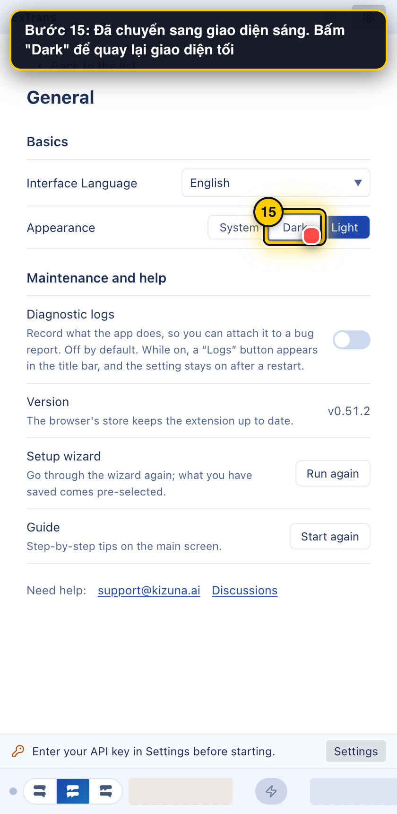 |

**Bước 16.** Bấm **Back to the list**, rồi **Back to the session** để về màn hình chính.

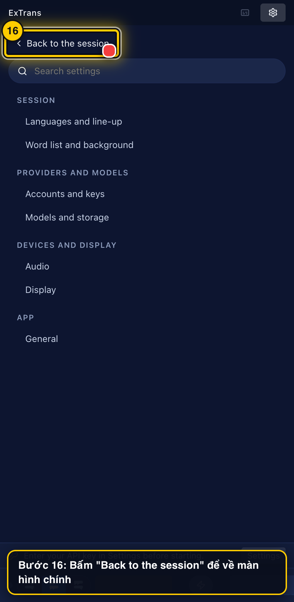

## 7. Xử lý sự cố

- **Không nghe/thấy gì, hoặc micro không hoạt động:** bấm biểu tượng ổ khóa cạnh thanh địa chỉ → cho phép **Microphone** cho ExTrans, rồi mở lại side panel. Kiểm tra micro đã chọn ở **Settings → Audio**.
- **Không có tiếng dịch:** chọn chế độ đúng (**Other** để dịch âm thanh của tab), kiểm tra âm lượng tab và thiết bị đầu ra trong **Settings → Audio**; trong cuộc họp, chọn "ExTrans Virtual Microphone" làm micro nếu muốn người khác nghe bản dịch.
- **Nút Start bị khóa / "API key invalid":** vào **Settings → Accounts and keys**, dán lại khóa (không thừa dấu cách), bấm **Validate**. Kiểm tra khóa còn hạn mức và đúng nhà cung cấp đã chọn.
- **Muốn đổi nhà cung cấp, ngôn ngữ hoặc làm lại từ đầu:** **Settings → General → Setup wizard → Run again**.

## Giấy phép

ExTrans dựa trên Sokuji của Kizuna AI Lab, được cấp phép theo AGPL-3.0.

ExTrans is based on Sokuji by Kizuna AI Lab, licensed under AGPL-3.0.
